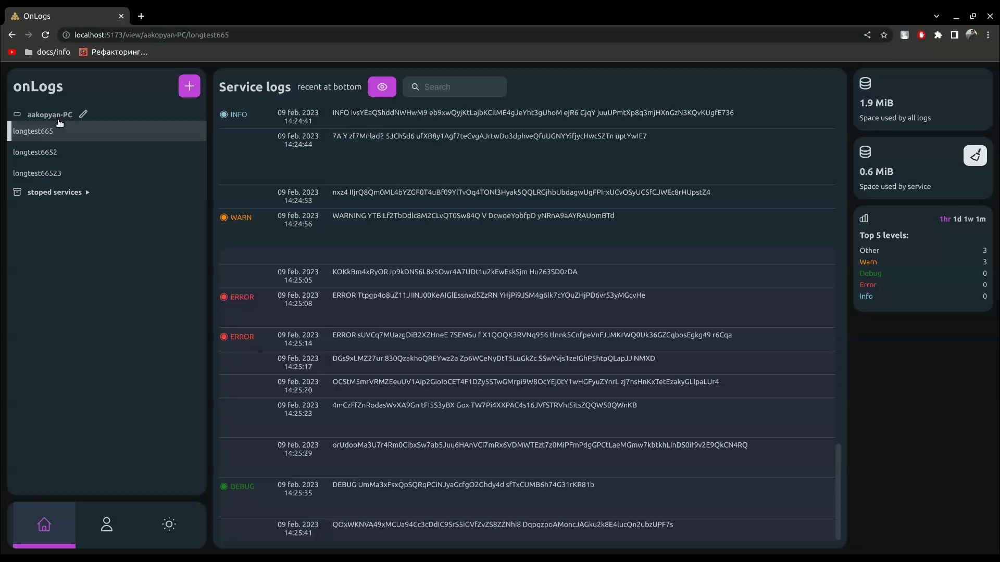

# OnLogs - Lightweight docker logs web viewer

<a href="https://devforth.io"></a>

   
[](http://tluma.ai/ask-ai/devforth/OnLogs)


### Benefits

- 🔑 Simple and secure way to access logs of any Docker containers without server/SSH connection
- 🏗️ Built with Golang & Svelte.js to extract maximum performance and keep the image and RAM footprint as small as possible. Logs storage implemented on top of lightweight LevelDB
- 🧸 Installation is easy as docker runs command/compose snippet. HTTP port exposed and could be routed from Nginx/Traefik/Directly
- 🖱 Get every service realtime logs stream with 1 click 
- 📱 Check logs from your smartphone (insane, but we know it happens that you need it)
- 🧾 Open-source, commercial-friendly MIT license
- 💾 Small size of Docker image (~ 13 MB)
- 👥 Share access to logs with team members, revoke any time

### Features

- 💻 One host can be used to view logs from all other hosts in case you are running Cluster
- 🔗 Share log messages to colleagues via link 
- 💽 Clear original docker logs of stopped containers to keep your storage size.
- 📊 Error/Info/Debug Statistics
- 🔎 Search through logs (configurable case sensitivity)
- 👁 View parameters (parsing JSON, showing local/UTC time for every logline)
- 🔴 Realtime logs updating
- 🗂 Group services into named folders in the sidebar, per user
- 📈 Prometheus metrics endpoint for log volume and OnLogs' own health

### Roadmap

- 🏷 Search and filter by tags (log status, time)
- 🔌Plugins and internal ability to notify about some event (e.g. notify when Error happens)

## Hello world & usage
### Docker Compose example with traefik
```sh
  onlogs:
    image: devforth/onlogs
    restart: always
    environment:
      - ADMIN_USERNAME=admin
      - ADMIN_PASSWORD=<any password>
      - PORT=8798
      - TRUSTED_PROXIES=172.16.0.0/12 # the docker network traefik reaches OnLogs over, see below
    #  - ONLOGS_PATH_PREFIX=/onlogs if want to use with path prefix

    labels:
      - "traefik.enable=true"
      - "traefik.http.routers.onlogs.rule=Host(`<your host>`)"  # if using on subdomain, e.g. https://onlogs.yourdomain.com
    #  - traefik.http.routers.onlogs.rule=PathPrefix(`/onlogs`) # if want to use with a path prefix, e.g. https://yourdomain.com/onlogs
      - "traefik.http.services.onlogs.loadbalancer.server.port=8798"
    volumes:
     - /var/run/docker.sock:/var/run/docker.sock
     - /var/lib/docker/containers:/var/lib/docker/containers # if you want to delete duplicating logs from docker
     - /etc/hostname:/etc/hostname
     - onlogs-volume:/leveldb

volumes:
  onlogs-volume:
```

### Docker Run example with traefik
```sh
docker run --restart always -e ADMIN_USERNAME=admin -e ADMIN_PASSWORD=<any password> -e PORT=8798 \
    -v /var/run/docker.sock:/var/run/docker.sock:ro \
    -v /var/lib/docker/containers:/var/lib/docker/containers \
    -v /etc/hostname:/etc/hostname \
    -v onlogs-volume:/leveldb \ 
    --label traefik.enable=true \
    --label traefik.http.routers.onlogs.rule=Host\(\`<your host>\`\) \ 
    --label traefik.http.services.onlogs.loadbalancer.server.port=8798 devforth/onlogs
```

Once done, just go to <your host> and login as "admin" with <any password>.

## Available Environment Options:
| Environment Variable       | Description   | Defaults | Required |
|----------------------------|---------------------------------|--------|-----------------|
| DOCKER_HOST              | URL of the docker socket to connect to. See below | `unix:///var/run/docker.sock` | |
| ADMIN_USERNAME           | Username for initial user                        | `admin`                 | if `AGENT=false`
| ADMIN_PASSWORD           | Password for initial user. Must not be empty — OnLogs refuses to start without it unless `DISABLE_AUTH=true` |                    | if `AGENT=false`
| PORT               | Port to listen on                                | `2874`             | if `AGENT=false`
| JWT_SECRET         | Secret for JWT tokens for users. Generated with `crypto/rand` on first start and persisted to `leveldb/JWT_secret`. Set it explicitly if you want sessions to survive the volume being recreated | Generates randomly | -
| ONLOGS_PATH_PREFIX | Base path if you using OnLogs not on subdomain   |                    | only if using on path prefix
| AGENT             | Toggles agent mode. If enabled, there will be no web interface available, and all logs will be sent  and stored on HOST. Parsed as a boolean, so `false`, `0` and an unset value all mean off | `false` | -
| HOST               | Url to OnLogs host from protocol to domain name. |                    | if `AGENT=true`
| ONLOGS_TOKEN       | Token that will use an agent to authorize and connect to HOST | Generates with OnLogs interface   | if `AGENT=true`
| ONLOGS_HOSTNAME    | Host name to store this machine's logs under when OnLogs would otherwise use its own container id, that is when `/etc/hostname` is not mounted and no `hostname` is set. Without it, OnLogs uses the Docker host's name, or else the container id, which changes on every recreate | Docker host name | -
| MAX_LOGS_SIZE | Maximum allowed total logs size before cleanup triggers. Accepts human-readable formats like 5GB, 500MB, 1.5GB etc. Counts only stored logs, their severity index and statistics, not stream cursors or agent buffers. When exceeded, the oldest logs across all hosts and containers are deleted until it fits, and old hosts left without logs are removed. Validated at startup: an unparseable value stops OnLogs rather than silently disabling retention | 10GB | -
| DISABLE_AUTH | Option to completely disable built in authentication in the application. When this option is set to `true` the app will behave like if the Administrator is logged in. The option to manage users will be removed. | false | -
| METRICS_TOKEN | Bearer token for the Prometheus endpoint at `/api/v1/metrics`. While it is unset the endpoint returns `401` and exposes nothing, so metrics are off by default. See [Metrics](#metrics) | | only for `/api/v1/metrics`
| TRUSTED_PROXIES | Peers allowed to name the client through `X-Forwarded-For` / `X-Real-IP`, as comma separated IPs and CIDR ranges. See [Behind a reverse proxy](#behind-a-reverse-proxy) | | only if behind nginx/traefik

## Behind a reverse proxy

Failed logins are rate limited per client address. Behind nginx or traefik every request
arrives from the proxy, so without `TRUSTED_PROXIES` all your users count as one client and
a single password sprayer locks out the rest. Set it to the addresses your proxy connects
from:

```
TRUSTED_PROXIES=172.16.0.0/12    # docker networks land here, so any containerised proxy does too
TRUSTED_PROXIES=127.0.0.1        # a proxy on the host
```

Keep the range as tight as your proxy allows — anything reaching OnLogs from a listed address
can call itself any client.

Without `X-Forwarded-For` all your users share the proxy's login limit. Without the original
`Host` header, logins and every change are refused as cross-origin (403). When TLS ends at the proxy it must send `X-Forwarded-Proto: https`, or
the session cookie is not marked `Secure`. The live tail is a WebSocket, so the proxy must
forward the upgrade too. traefik does all of this by default. For nginx:

```nginx
location / {    # with ONLOGS_PATH_PREFIX=/onlogs use location /onlogs/
    proxy_pass http://onlogs:2874;    # OnLogs' PORT: 2874 by default, 8798 in the examples above
    proxy_http_version 1.1;
    proxy_set_header Upgrade $http_upgrade;
    proxy_set_header Connection "upgrade";
    proxy_set_header Host $http_host;
    proxy_set_header X-Forwarded-For $proxy_add_x_forwarded_for;
    proxy_set_header X-Forwarded-Proto $scheme;
}
```

## Metrics

Prometheus metrics at `${ONLOGS_PATH_PREFIX}/api/v1/metrics`. Set `METRICS_TOKEN` to enable
them — while it is unset every request gets a `401`, since the endpoint reveals container
names and log volumes.

```yaml
scrape_configs:
  - job_name: onlogs
    metrics_path: /api/v1/metrics
    authorization:
      credentials: <your METRICS_TOKEN>
    static_configs:
      - targets: ["onlogs:2874"]  # OnLogs' PORT, as in the nginx example
```

| metric | labels | meaning |
|---|---|---|
| `onlogs_log_lines_total` | host, container, level | Log lines stored, by severity |
| `onlogs_stream_up` | host, container | 1 while a container's stream is attached |
| `onlogs_stream_cursor_timestamp_seconds` | host, container | Newest line ingested |
| `onlogs_docker_log_bytes` | host, container | Size of the container's docker log file |
| `onlogs_agent_last_report_timestamp_seconds` | host | When an agent last reported |
| `onlogs_dropped_replay_lines_total` | host, container | Lines dropped as replays |
| `onlogs_logs_size_bytes` / `_limit_bytes` | | Stored size on disk, and `MAX_LOGS_SIZE`. The size can exceed the limit by stream cursors and agent buffers, which the quota does not count |
| `onlogs_container_db_size_bytes` | host, container | Stored size per container |
| `onlogs_retention_deleted_lines_total` | | Lines deleted by the quota |
| `onlogs_filesystem_size_bytes` / `_avail_bytes` | | The filesystem holding the logs |
| `onlogs_stats_workers`, `onlogs_websocket_connections` | | Workers and live viewers |
| `onlogs_goroutines`, `onlogs_heap_bytes` | | Process health |
| `onlogs_login_failures_total`, `onlogs_login_blocked_total` | | Rejected and blocked logins |
| `onlogs_build_info` | version | Always 1 |

Alert on error rate, on ingestion stalling while docker still writes, and on a silent agent:

```yaml
- alert: OnLogsContainerErrors
  expr: sum by (host, container) (rate(onlogs_log_lines_total{level="error"}[5m])) > 1
  for: 10m

- alert: OnLogsIngestStalled
  expr: |
    (time() - onlogs_stream_cursor_timestamp_seconds > 300)
      and on (host, container) (changes(onlogs_docker_log_bytes[10m]) > 0)
  for: 5m

- alert: OnLogsAgentSilent
  expr: time() - onlogs_agent_last_report_timestamp_seconds > 180
  for: 2m
```

Worth knowing: `onlogs_stream_up`, the cursor and `onlogs_docker_log_bytes` cover the
master's own containers only, and the docker log size needs the
`/var/lib/docker/containers` mount; agents are covered by `OnLogsAgentSilent`;
size gauges refresh every 5 minutes and the limit is read once at startup; counters reset
on restart, as usual; and at most 1000 host/container pairs are counted.

## Upgrading from 1.x

Your logs are safe — nothing in the volume is migrated or deleted.

**Check these three first, or the container will not start:**

| Variable | What changed |
|---|---|
| `ADMIN_PASSWORD` | Must not be empty, unless `DISABLE_AUTH=true`. The 1.3.1 `docker run` example set `PASSWORD=` by mistake — if you copied it, fix the name. |
| `MAX_LOGS_SIZE` | Must be a valid size if you set it. Leaving it unset is fine. |
| `AGENT` | Now a real boolean. `AGENT=false` used to mean *on*, so you may have been running without a web interface by accident. `yes` and `on` no longer work. |

**Everyone is logged out once.** 1.3.1 signed sessions with an empty key, which anyone
could forge. A real secret is generated on first start — set `JWT_SECRET` yourself if you
want sessions to survive the volume being recreated.

Smaller changes: passwords are now hashed (rotate them if the database may have been
exposed); favourites are per user and need starring again; log levels are matched
case-insensitively, so charts change shape at the upgrade; live tailing and every state-changing request
(the `Origin` header must match the request host) need your reverse
proxy to forward the original `Host` header.

**Pin the image tag.** `compose up` never pulls `:latest` again, so an install that pulled it
before 3 March 2026 still runs 1.1.10 and moves to 2.x unannounced once the cached image is
pruned. Use `devforth/onlogs:<version>` and upgrade on purpose. Skip 2.0.1: its log
retention can fill the disk.

**Host name.** Without the `/etc/hostname` mount, older versions named the host after the
OnLogs container id, so every recreate started a new host. OnLogs now uses `ONLOGS_HOSTNAME`
or the Docker host's name. Behind the socket proxy, which hides the host's name, set
`ONLOGS_HOSTNAME` or mount `/etc/hostname`. Do the same where Docker host names repeat, as on
cloned VMs or Docker Desktop, or those machines share one host. Logs under old names stay
visible, are deleted first when `MAX_LOGS_SIZE` is reached, and an old host disappears once
empty. 1.x could also mix one host's logs into another after a recreate; 2.x keeps hosts
apart.

## Docker socket URL
By default the app will connect using the raw unix socket. But this can be overriden via the ENV variable `DOCKER_HOST`. That way you can specify fully qualified URL to the socket or URL of an docker socket proxy.

In `compose-socket-proxy.yml` you can see a sample compose file for starting the socket proxy. To use it in the app set `DOCKER_HOST=http://localhost:2375` in the ENV.

## Local Docker testing

Use the local test compose to run `onlogs + socket-proxy + logprinter` together:

```sh
cd application
docker compose -f compose-local-test.yml up --build
```

Open `http://localhost:2874` and login with:

- Username: `admin`
- Password: `admin`

Stop containers:

```sh
docker compose -f compose-local-test.yml down
```

Stop and remove volumes too (clean state):

```sh
docker compose -f compose-local-test.yml down -v
```
